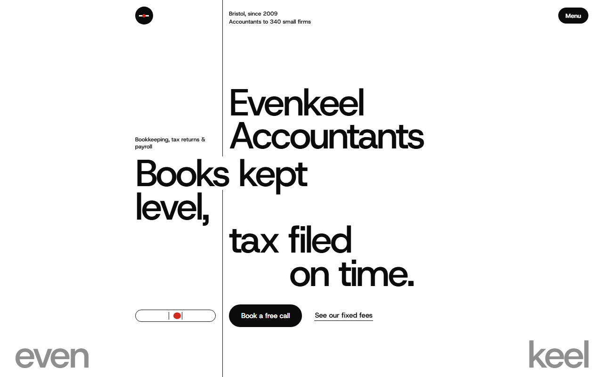
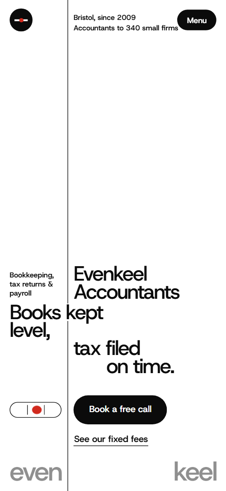
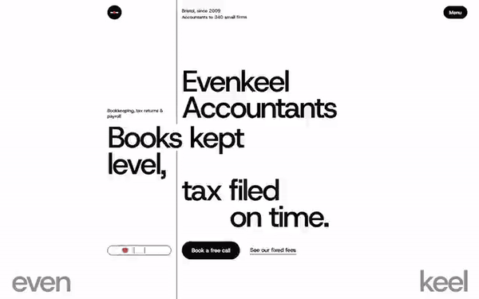

# Free HTML accounting firm website template with scroll animations and no libraries

Accounting firm website template: one free HTML file for a practice that keeps books, files tax returns and runs payroll, with a service ledger, a fee table, a section on switching accountants and a call-booking form. The look is Swiss: black type on white, one red accent, a hairline rule that the type hangs on. The scroll motion runs on CSS with no JavaScript libraries, and AGENTS.md lets Claude Code, Cursor or Codex adapt it.

[](LICENSE)  

**[Live demo](https://8bsite.github.io/accounting-firm-website-template/)** · **[Use this template](https://github.com/new?template_name=accounting-firm-website-template&template_owner=8bsite)** · **[Download ZIP](https://github.com/8bsite/accounting-firm-website-template/archive/refs/heads/main.zip)** · **[Template page on 8b.com](https://8b.com/templates/evenkeel/)**

<a href="https://8bsite.github.io/accounting-firm-website-template/"></a> <a href="https://8bsite.github.io/accounting-firm-website-template/"></a>

<p align="center"><a href="https://8bsite.github.io/accounting-firm-website-template/"></a><br><sub>Scroll animation</sub></p>

## Use it with Claude Code, Cursor or Codex

Download the four files into your project folder (`curl.exe` in Windows PowerShell):

```bash
curl -LO https://raw.githubusercontent.com/8bsite/accounting-firm-website-template/main/index.html
curl -LO https://raw.githubusercontent.com/8bsite/accounting-firm-website-template/main/AGENTS.md
curl -LO https://raw.githubusercontent.com/8bsite/accounting-firm-website-template/main/LICENSE
curl -LO https://raw.githubusercontent.com/8bsite/accounting-firm-website-template/main/CREDITS.md
```

Then fill in the angle brackets and give your agent this prompt:

```text
Read AGENTS.md, then edit index.html. Make this the site for <my firm: name, address, year founded, services, country and tax terms, fee plans with prices, opening hours, team names and roles, how people book a first call, legal name and company number>. Replace first the firm name, UK tax terms, fees, client cards, team and reviews. Keep the section ids, each sphere card's lat and lon, and set the footer wordmark's len to the new name's character count. Motion is CSS scroll-driven animation plus the inline kit: keep the gate script, data-8b-section and data-8b-motion; add no animation library. Never invent fees, deadlines, client names, reviews or contacts; ask me.
```

If you vibe code the site, this accounting firm website template for Claude Code, Cursor or Codex goes fastest when you give the agent the facts only the practice has: fees, payroll and filing deadlines, founding year, client numbers, opening hours, team and company number. The demo invents every one of them, along with the reviews and the client names on the sphere. The agent should then replace the old name wherever it appears, split the new name across the footer wordmark and the grey corner halves the same way, and set the wordmark's --len to the name's character count. Leave the section ids and the classes AGENTS.md lists alone.

No agent? Click **[Use this template](https://github.com/new?template_name=accounting-firm-website-template&template_owner=8bsite)**, edit `index.html` on GitHub and turn on **Settings > Pages**.

## Sections and motion

- **Navigation**: round logo mark top-left and a Menu button; full-screen menu with section links, address and phone.
- **Evenkeel Accountants**: two screens: big type hung on a vertical hairline rule with a booking button, then a black screen with a statement, a paragraph and four photos. On load the rule draws down and the lines slide out from it; on scroll the big type parts at the rule, the black screen opens from a slit there and four photos rise unevenly. With a mouse the wheel scrolls smoothly page-wide.
- **Four things we keep for you.**: ledger of four services: what the client sends left of the rule, what the firm returns right of it, how often. Row by row, hairlines draw across and the two columns slide in from opposite sides of the rule.
- **A month on the books**: a month drawn as a ruler: a red marker sweeps across and four dated tasks turn from grey to black. Held in place while you scroll: a red marker crosses the month's ruler, turning each dated task from grey to black and its day label red.
- **Clients since 2009**: turning 3D sphere of 28 client cards (names and photos) between the two halves of the title. Held in place while you scroll: the sphere of client cards rises and turns almost a full circle as the title's two halves part.
- **Fixed fees, paid monthly.**: fee table: four plans in hairline rows with who each is for, what is included and the monthly fee. Each fee row draws its rule across and its fee slides in from the right on arrival.
- **Moving to us takes one afternoon.**: three steps of moving from another accountant, each tile completing with a closing red ring. Held in place while you scroll: three red rings close in turn, and each tile turns black when its ring completes.
- **Four people, one desk.**: four team portraits with names, roles and one line each. The four team cards start piled and tilted mid-row and deal out to their places as you scroll.
- **Principle**: one large staggered quote on the rule, ending in a red full stop. Each quote line thickens from light to medium weight as it reaches the reading line, and the red full stop pops in as the last line rises.
- **Questions we hear every week.**: questions and answers (native &lt;details&gt;). A hairline draws across above each question on arrival; opening one turns its plus into a minus.
- **What our clients say.**: four client reviews on sheets that stack as you scroll. Review sheets stick near the top and stack, each shrinking slightly as the next slides over.
- **Book a free first call.**: opening hours set large in brackets with a small photo, phone, email, address and a call-booking form (placeholders). Phone, email, office and first-call details slide in from the left as they scroll into view.
- **Footer**: tagline, links, call/email/map icons, the full-width wordmark in two halves, copyright and the Design: 8B credit. The grey half-names waiting in the screen corners drop away as the full-width wordmark grows out of them.

## Design

 page background, white review sheets, text on the black screen  
 text, vertical rule, buttons, black second screen, switch tiles once their ring closes  
 grey client cards, alternate review sheets, switch tiles waiting for their ring  
 labels, column heads, roles, captions, month tasks the marker has not reached  
 grey wordmark halves in the screen corners, ring tracks  
 the only accent: level bubble, logo dot, month marker, rings, button hover, full stop  
 hairlines between service rows and under each fee item

**Host Grotesk**: the only typeface: huge, tight medium-weight headings, small semibold labels, regular body text, and a quote that moves from light to medium weight (Google Fonts). A vertical hairline rule sits a little over a third of the way across on a desktop, and the type hangs on it: heading lines are staggered, some starting left of the rule and some just right of it, and the services read as ledger rows across it, with the fee table using the same columns. The rule returns in the switching and contact sections and in the menu. Photos are greyscale. A small spirit level drawn in CSS, with a rocking red bubble, sits beside the booking button on the first screen.

## Questions

**Can CPA firm websites in the US use it?**  
Yes, after a text pass. The layout, the fee table and the booking form suit any practice, but the demo copy is British: amounts in pounds, VAT, HMRC, Making Tax Digital, self-assessment, corporation tax and statutory accounts appear in the services, prices, questions and team. Swap them for your own terms and it becomes a CPA website template.

**Where does the first-call form send its messages?**  
Nowhere yet. The form requires a name and an email, then shows a thank-you line and clears the fields without sending anything. Connect Formspree or Netlify Forms with the steps in AGENTS.md, or delete the form and keep the email link. Also edit the thank-you line, which promises a call within one working day.

**Does this version need GSAP, Lenis or another library?**  
No. The scroll motion is CSS scroll-driven animation, and a short inline script measures the page, marks rows as they arrive and smooths the mouse wheel. Nothing changes for the visitor, and the page loads a little over a third of the code: about 26 KB gzipped in one file against 71 KB, with three fewer requests. The font and photos still come from Google and Unsplash.

## Is it the right base?

As an accounting website template it suits a firm that sells fixed monthly services to small businesses and wants to sound calm and exact. This light build has the same look and the same scroll behaviour, with no animation library and no script from a CDN. It downloads about 26 KB of code gzipped in one file; the GSAP version needs 71 KB and three extra requests. If you want flat colour slabs and an annual report look in your accounting website design, the [accountancy](https://8b.com/templates/tallyhouse/) template comes closer. Booking is the thin part: the button jumps to a form that sends nothing until a service is connected, with no calendar.

## Before you publish

- Replace what is marked `data-8b-placeholder` (social preview image, favicon, phone, email, form, map) and the invented demo facts; [AGENTS.md](AGENTS.md) lists them.
- The form sends nothing yet: connect it to Formspree or Netlify Forms, or remove it.

## Tech

No JavaScript libraries: CSS scroll-driven animations and a small inline motion script with its own smooth wheel scrolling, 96 KB, no build step. Chrome and Edge 108+, Safari 15.4+, Firefox 121+ (it uses :has(), cascade layers, small/dynamic viewport units). Without scroll-driven animations (Firefox today) the scroll motion and the smooth wheel are off and each section shows its finished layout, while any load-in or looping animation still plays; with "reduce motion" on, the page is complete and nothing moves on its own (hover effects stay).

A GSAP build of the same page is [`index.gsap.html`](index.gsap.html): GSAP 3.13.0, ScrollTrigger, Lenis 1.3.27 from jsDelivr, 88 KB; its scroll motion also plays in Firefox. Use one of the two files.

## License

MIT, see [LICENSE](LICENSE). Photos, fonts and libraries keep their own licences: [CREDITS.md](CREDITS.md). More free templates: [8b.com/templates](https://8b.com/templates/) · [github.com/8bsite](https://github.com/8bsite).
