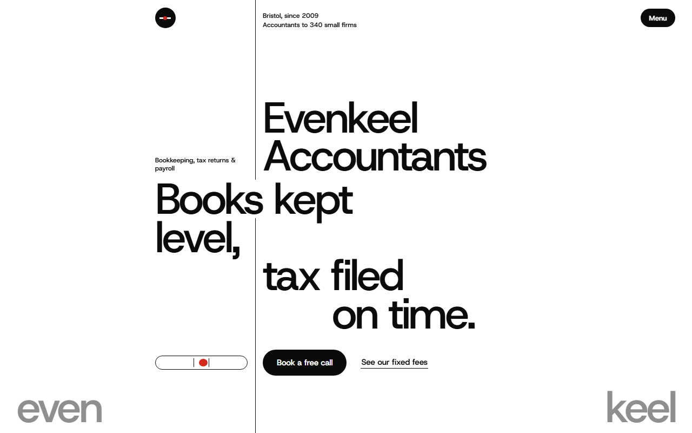
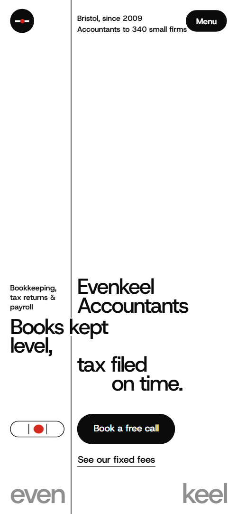
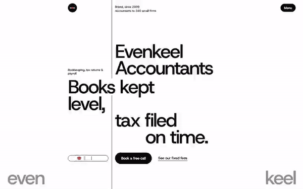

# Free HTML accounting firm website template with GSAP scroll animations — Evenkeel

**One-page website for an accounting and bookkeeping firm that works for small businesses: a free HTML template in one file, with GSAP scroll animations, no build step, MIT license. Made by [8B](https://8b.com/), the AI website builder.**

[](LICENSE)  

**[Live demo](https://8bsite.github.io/accounting-firm-website-template/)** · **[Use this template](https://github.com/new?template_name=accounting-firm-website-template&template_owner=8bsite)** · **[Download ZIP](https://github.com/8bsite/accounting-firm-website-template/archive/refs/heads/main.zip)** · **[Template page on 8b.com](https://8b.com/templates/evenkeel/)**

<a href="https://8bsite.github.io/accounting-firm-website-template/"></a> <a href="https://8bsite.github.io/accounting-firm-website-template/"></a>

<p align="center"><a href="https://8bsite.github.io/accounting-firm-website-template/"></a><br><sub>Scroll animation</sub></p>

A one-page site for a small firm of accountants in Bristol: services, a month of work, clients, fixed fees, team, reviews and a booking form. Swiss and strict: black type on white hung on one hairline rule like a ledger, a turning sphere of client cards, a month drawn as a ruler with a red marker, and the brand's two halves meeting in the footer.

Good for: accounting or bookkeeping firm; tax adviser or payroll bureau; small professional practice with fixed fees (lawyer, consultant, financial planner); any service business that wants a calm, typographic, black-and-white look.

## Use it with an AI coding agent

Download the files into your project (in Windows PowerShell type `curl.exe`):

```bash
curl -LO https://raw.githubusercontent.com/8bsite/accounting-firm-website-template/main/index.html
curl -LO https://raw.githubusercontent.com/8bsite/accounting-firm-website-template/main/AGENTS.md
curl -LO https://raw.githubusercontent.com/8bsite/accounting-firm-website-template/main/LICENSE
curl -LO https://raw.githubusercontent.com/8bsite/accounting-firm-website-template/main/CREDITS.md
```

Then give your agent this prompt:

```text
Read AGENTS.md, then edit index.html. Use this template as the base for a website for <your firm: what you do (accounts, tax, payroll…), for whom, where, your fees, opening hours and how clients book a call>. Keep the layout, the motion and the single-file format; replace the brand name, copy, client list, team, reviews, prices, photos, links and contacts, adapt the UK tax terms to your country, and recolour it through the CSS variables if needed.
```

Give the agent the downloaded file, not a link: from a link it would rebuild a different page. No agent? Click **[Use this template](https://github.com/new?template_name=accounting-firm-website-template&template_owner=8bsite)**, edit `index.html` and turn on **Settings → Pages**.

## What's on the page

- **Navigation** — round logo mark top-left and a Menu button; full-screen menu with section links, address and phone
- **Evenkeel Accountants** — two screens: big type hung on a vertical hairline rule with a booking button, then a black screen with a statement, a paragraph and four photos
- **Four things we keep for you.** — ledger of four services: what the client sends left of the rule, what the firm returns right of it, how often
- **A month on the books** — a month drawn as a ruler: a red marker sweeps across and four dated tasks turn from grey to black
- **Clients since 2009** — turning 3D sphere of 28 client cards (names and photos) between the two halves of the title
- **Fixed fees, paid monthly.** — fee table: four plans in hairline rows with who each is for, what is included and the monthly fee
- **Moving to us takes one afternoon.** — three steps of moving from another accountant, each tile completing with a closing red ring
- **Four people, one desk.** — four team portraits with names, roles and one line each
- **Principle** — one large staggered quote on the rule, ending in a red full stop
- **Questions we hear every week.** — questions and answers (native &lt;details&gt;)
- **What our clients say.** — four client reviews on sheets that stack as you scroll
- **Book a free first call.** — opening hours set large in brackets with a small photo, phone, email, address and a call-booking form (placeholders)
- **Footer** — tagline, links, call/email/map icons, the full-width wordmark in two halves, copyright and the Design: 8B credit

## Design

Palette:         
Fonts: Host Grotesk (Google Fonts). Change both through the CSS variables in the `:root` block at the top of `<head>`.

- The spirit-level vial, the logo mark, the vertical rule and the rings in the switch section are CSS and SVG, not images: recolour them through the CSS variables.
- Client cards sit on the sphere by their inline --lat and --lon angles. To add a card, give it its own pair (spread them evenly); a card without them sits on the pole on top of another.
- The brand name is split in two halves in two places: the footer wordmark (.ft-a, .ft-b; its style="--len:8" is the number of characters of the whole word and sizes it to fill the width) and the grey corner halves (.ghost__a, .ghost__b). Split your name the same way, or put the whole name in the first half and leave the second empty.

## Before you publish

- Replace everything marked `data-8b-placeholder` (social preview image, favicon, phone, email, form, map) and the invented demo facts: prices, dates, address. [AGENTS.md](AGENTS.md) lists them.
- The form sends nothing yet: connect it to Formspree or Netlify Forms, or remove it.

## Tech

GSAP 3.13.0, ScrollTrigger, Lenis 1.3.27 from jsDelivr, 86 KB, no build step. Chrome and Edge 108+, Safari 15.4+, Firefox 121+ (it uses :has(), cascade layers, small/dynamic viewport units). With "reduce motion" on, the page is complete and still.

## License

MIT, see [LICENSE](LICENSE). Photos, fonts and libraries keep their own licences: [CREDITS.md](CREDITS.md). More free templates: [8b.com/templates](https://8b.com/templates/) · [github.com/8bsite](https://github.com/8bsite).
